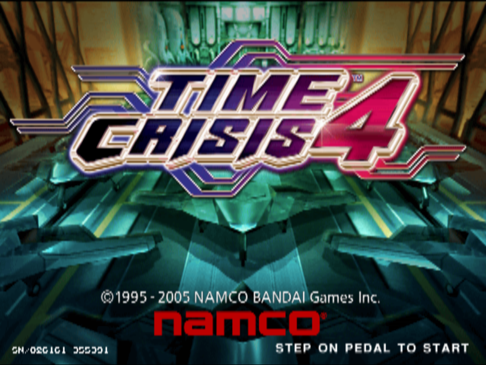

# Time Crisis 4 Native

A separate Time Crisis 4 project using the Linux/Vulkan/Nuklear compatibility
foundation developed in [TimeCrisis3-Native](https://github.com/CrownParkComputing/TimeCrisis3-Native).
The current milestone is a **linked twin-cabinet pair running the real TC4 game
with its own inter-cabinet link protocol**, direct EEPROM service settings and a
native configuration menu. Complete native translation of the game's own code
and Android playability are unfinished.



This is an actual TC4 renderer screenshot from the World TSF1002/A49 package,
captured with the foundation's F8 screenshot command on 24 October 2026.

## Build the shared foundation

Target: Linux x86-64 with Vulkan. Build the playable target using the foundation's
README, then point this project's launcher at that checkout. The path is
configurable; no particular sibling directory is required.

```sh
git clone https://github.com/CrownParkComputing/TimeCrisis3-Native.git /path/to/TimeCrisis3-Native
export TC3_NATIVE_ROOT=/path/to/TimeCrisis3-Native
git -C "$TC3_NATIVE_ROOT" checkout 74880d42caa7107dd443ebc993677930b1a1b6d6
# Follow that checkout's build/dependency instructions first.
test -x "$TC3_NATIVE_ROOT/.local/core-build/bin/tc3-native"
```

The tested foundation commit is pinned in [foundation.lock.json](foundation.lock.json).
Build that revision to include the TC4 title, cabinet/test, Sinden and twin-launch gates.

The executable currently retains the `tc3-native` filename. Its in-process
PCSX2-derived core loads TC4's own manifest, firmware, HDD and dongle; this
repository does not pretend that those execution components are already fully
translated native TC4 code. See [STATUS.md](STATUS.md) for the tested scope.

## Prepare your own game files

No game, BIOS, dongle or HDD data is included. Install `unsquashfs` and Python 3.11
or later, then supply the known World TSF1002/A49 assets:

- `Time Crisis 4.squashfs`, containing the HDD CHD, `proverb.elf`, SRAM and manifest.
- Your `256_memcards.zip`, containing `256_memcards/timecrs4-tsf1002-na-a.bin`.
- Your existing `246C.bin`, `246C.nvm` and `246C.mec` BIOS directory.

```sh
python3 tools/prepare_tc4.py \
  --package '/path/to/Time Crisis 4.squashfs' \
  --cards /path/to/256_memcards.zip \
  --bios-dir /path/to/bios
```

Preparation verifies the known asset hashes and creates private storage beneath
`.local/`. Mutable settings, memory cards and SRAM are independent copies and are
preserved when preparation is repeated. HDD storage needs several gigabytes of
free space. Original supplied assets are opened for reading only.

## Run TC4

```sh
python3 tools/run_tc4.py --dry-run
python3 tools/run_tc4.py
# A bounded diagnostic, or a background session:
python3 tools/run_tc4.py --seconds 90
python3 tools/run_tc4.py --background
```

Use `--foundation /path/to/checkout` instead of the environment variable if
preferred. Use `--data-root` to select another prepared private TC4 directory.
The launcher checks for TC4's `NM00032`/Super256/HDD manifest and disables the
TC3-specific cabinet transport environment.

Mouse aiming, left-button trigger, Space pedal, `5` coin and Return start are
configured as the input baseline. **F10** opens the shared Nuklear menu;
arrow keys and Enter navigate it; Escape resumes. **F8** captures the renderer's
own game image. Actual TC4 gun calibration, shot alignment and full gameplay
have not yet been validated. TC4 is a lightgun cabinet: input is mouse or
Sinden gun plus keyboard only; gamepads are not mapped on this title.

The shared menu has three tabs — **File**, **Display & Rendering** and
**Cabinet / Service**:

- **Display & Rendering**: window mode (arcade pair / fullscreen / windowed),
  twin-screen launch and linked-at-boot default, display size, aspect ratio,
  internal resolution 1–4x, NVIDIA DLSS presets when a supported GPU is
  detected, frame skip, VSync and Sinden border mode/width. Everything applies
  atomically to both cabinets and is persisted.
- **Cabinet / Service**: edits the original cabinet options directly — player's
  life, difficulty, hit color, free play, game cost, continue cost and attract
  sound. **Save & Reset Machine** writes the `TSF100-2-NA` EEPROM block with a
  valid TC4 CRC16 checksum and reboots both linked screens together. Service
  credit and coin insert are also here; **F9** still opens the original test
  menu for diagnostics. Settings no longer require navigating that menu.

The foundation also provides Sinden USB detection and an inset white border:
Display & Rendering → Sinden white border → Auto detect/On. Start the official
Sinden Linux driver separately using [Sinden driver instructions](docs/SINDEN.md).
A physical Sinden device and TC4 calibration have not been tested here.

See [cabinet maintenance controls](docs/CABINET_TEST.md) and [Sinden setup](docs/SINDEN.md).

## Dual screens

```sh
python3 tools/run_tc4.py --dual-screen
```

Launches the linked left/right cabinet pair through the shared twin supervisor.
A native bridge replaces TC4's AN986 USB-Ethernet stack: it exchanges the game's
own `0x440`-byte MD5-authenticated link frames between the two workers over a
local socket, so `LINK : ON`, `LINK AS : 1 (LEFT)` / `2 (RIGHT)` and the linked
test menu work as on the real cabinet. Live verification covered the handshake,
60 Hz packet exchange in both directions, and synchronized EEPROM save/reset on
both machines. One worker is muted so the pair produces a single sound source;
closing either side closes the pair.

Full linked **gameplay** beyond packet/test-menu exchange still needs staged
validation. [Dual-screen notes](docs/DUAL_SCREEN.md) explain the transport and
acceptance checks.

## Native vs emulated split

"Native" means code these projects own and run directly on Linux; "emulated"
means original PlayStation 2 / Super256 code still executed inside the
in-process PCSX2-derived compatibility core.

| Layer | What it is | Split |
| --- | --- | --- |
| Host, UI, input & cabinet layer | SDL3 windows, paired-cabinet layout, Nuklear menu, direct EEPROM writer, gun/mouse input, shared `control.bin` sync | ~100% native C++/Python |
| Arcade I/O & link hardware | Native HLE for the NA-JV JVS board, gun scaling, SRAM, HDD/CHD reader, and the AN986/UDP EE link bridge | ~100% native C++ HLE (replaces the cabinet PCB & link hardware) |
| GPU presentation | PS2 GS primitives translated to native Vulkan draw calls with scaling, widescreen/aspect composition and frame pacing | Hybrid: native Vulkan backend fed by the emulated GS stream |
| Game code & audio | The original TC4LOAD EE/VU/IOP programs and SPU2 mixing run via the x86-64 JIT recompiler | ~0% statically recompiled; executed on the compatibility core |

Roughly **~45% of the runtime is native host/arcade infrastructure and ~55% is
the emulated core** by subsystem weight; **0% of TC4LOAD's own code has been
statically translated**. The original game still runs — the project wraps it in
a fully native cabinet experience.

### Next steps toward 100% native

1. Statically recompile TC4LOAD's EE/VU programs (PS2Recomp pipeline) and retire
   the JIT core for gameplay code.
2. Replace the remaining IOP module emulation (INET/LIBNET, ACSRAM, JVS) with
   the native contracts already proven by the link bridge and EEPROM writer.
3. Reimplement the GS renderer natively against the game's draw command stream
   rather than generic GS emulation.
4. Replace SPU2 emulation with a native mixer fed by the game's audio engine.
5. Validate with matched replays: full-stage completion, gun calibration, audio
   equivalence and linked gameplay end-to-end.

## Validation and screenshots

```sh
python3 -m unittest discover -s tests -v
python3 tools/prepare_tc4.py --help
python3 tools/run_tc4.py --help
```

The screenshots in [docs/screenshots](docs/screenshots) are authentic TC4 output.
Private logs, input hashes and raw snapshots remain under `.local/`; they are not
published. The code is GPL-3.0-or-later; see [COPYING](COPYING).
